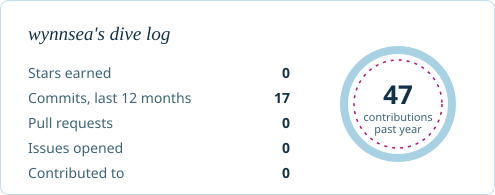
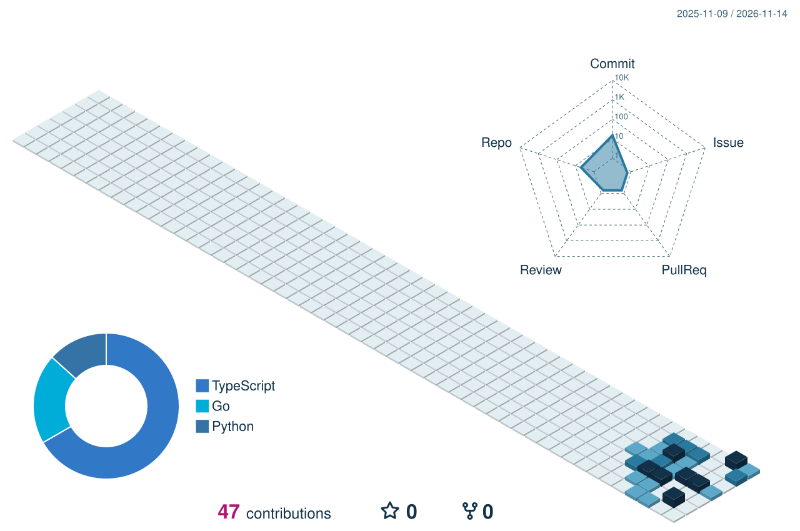
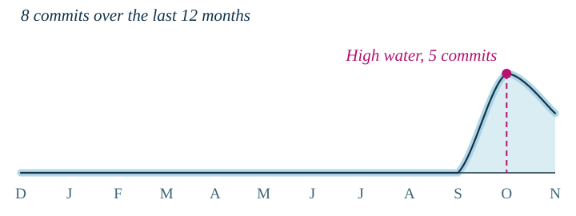

<!-- Everything marked DUMMY below is placeholder content. Replace it before pushing. -->
<!-- Anime GIFs are Grand Blue clips hosted on Tenor. Swap any of them by changing the src. -->

<h2 align="center">🌊 Hi, I'm Wynn!</h2>

  
  <!-- DUMMY: replace example.com with your real profiles, or delete the icons you don't use -->
  
  
  

### About me

<table>
  <tr><td>💻 Backend developer, building web apps</td></tr>
  <tr><td>📍 Bekasi, Indonesia</td></tr>
  <!-- DUMMY: Building, Learning, Open to and Love to -->
  <tr><td>🚧 <b>Building:</b> harbor, a status page</td></tr>
  <tr><td>📚 <b>Learning:</b> Rust</td></tr>
  <tr><td>🤝 <b>Open to:</b> freelance backend work</td></tr>
  <tr><td>💙 <b>Love to:</b> code, dive, repeat</td></tr>
  <tr><td>🐧 <b>Environment:</b> Linux, zsh, VS Code</td></tr>
  <tr><td>🌐 <b>Portfolio:</b> <a href="https://wynnsea.my.id">wynnsea.my.id</a></td></tr>
</table>

 

### GitHub stats

<!-- The dive log, commit tide and 3D blocks are redrawn every day by .github/workflows/update-profile.yml -->

<picture>
  <source media="(prefers-color-scheme: dark)" srcset="assets/divelog-dark.svg">
  
</picture>
 
<picture>
  <source media="(prefers-color-scheme: dark)" srcset="https://streak-stats.demolab.com?user=wynnsea&background=0C2638&border=1C4760&stroke=1C4760&ring=5BC0EB&fire=F06CB8&currStreakNum=E9F3F2&sideNums=E9F3F2&currStreakLabel=5BC0EB&sideLabels=86AEBF&dates=86AEBF&hide_border=true">
  
</picture>

 

<picture>
  <source media="(prefers-color-scheme: dark)" srcset="assets/tide-dark.svg">
  
</picture>

### Projects

<!-- Filled in automatically from your pinned repos. Edits between these markers get overwritten. -->
<!-- projects:start -->
| Project | Built with |
| :--- | :--- |
| [ai-audit](https://github.com/wynnsea/ai-audit) | TypeScript |
| [ai-audit-service](https://github.com/wynnsea/ai-audit-service) | Go |
| [ai-portfolio](https://github.com/wynnsea/ai-portfolio) | TypeScript |
| [ringgit-catering](https://github.com/wynnsea/ringgit-catering) | TypeScript |
<!-- projects:end -->

<h3 align="center">⚓ Languages, frameworks and tools ⚓</h3>

  

  

<picture>
  <source media="(prefers-color-scheme: dark)" srcset="assets/hero-dark.svg">
  
</picture>

Made with 🌊 by <a href="https://github.com/wynnsea">wynnsea</a>

