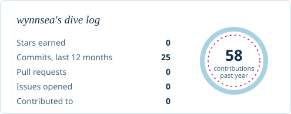
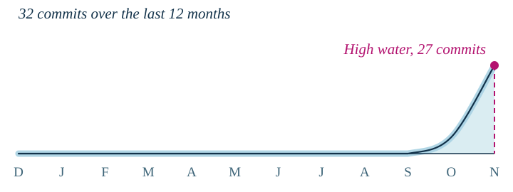
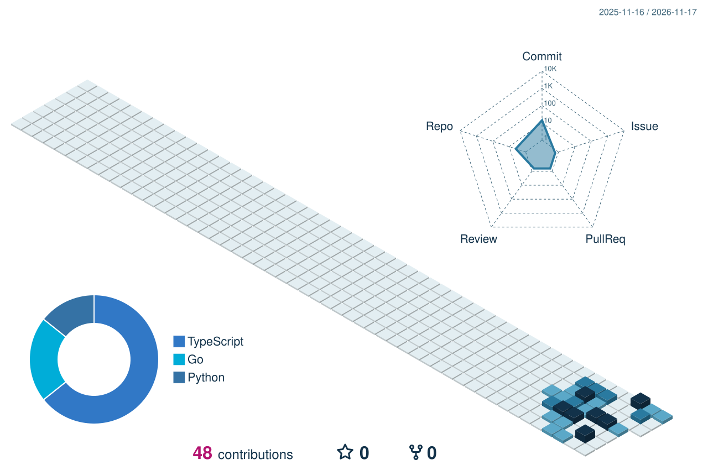

<!-- Everything marked DUMMY below is placeholder content. Replace it before pushing. -->

<picture>
  <source media="(prefers-color-scheme: dark)" srcset="assets/hero-dark.svg">
  
</picture>

<h3 align="center">Hi, I'm Wynn</h3>

  Backend developer building clean, fast web apps · Bekasi, Indonesia

  <a href="https://wynnsea.my.id">Portfolio</a>
  &nbsp;·&nbsp;
  <a href="mailto:wayaandeva123@gmail.com">Email</a>
  <!-- DUMMY: replace example.com with your real profiles, or delete the links you don't use -->
  &nbsp;·&nbsp;
  <a href="https://linkedin.com/in/example">LinkedIn</a>
  &nbsp;·&nbsp;
  <a href="https://instagram.com/example">Instagram</a>
  &nbsp;·&nbsp;
  <a href="https://discord.com/users/example">Discord</a>

 

### About

Backend developer focused on web services, APIs, and small developer tools.

<!-- DUMMY: Building, Learning, and Availability -->
- **Building** — `harbor`, a self-hosted status page
- **Learning** — Rust
- **Environment** — Linux, zsh, VS Code
- **Availability** — Open to freelance backend work

### Projects

<!-- Filled in automatically from your pinned repos. Edits between these markers get overwritten. -->
<!-- projects:start -->
| Project | Built with |
| :--- | :--- |
| [ai-portfolio](https://github.com/wynnsea/ai-portfolio) | TypeScript |
| [inventory-manajemen](https://github.com/wynnsea/inventory-manajemen) | PHP |
| [synseafy](https://github.com/wynnsea/synseafy) | TypeScript |
| [ai-audit](https://github.com/wynnsea/ai-audit) | TypeScript |
| [ai-audit-service](https://github.com/wynnsea/ai-audit-service) | Go |
<!-- projects:end -->

### Stack

  <picture>
    <source media="(prefers-color-scheme: dark)" srcset="https://skillicons.dev/icons?i=go,ts,rust,postgres,redis,docker,githubactions,linux,git,vscode&perline=10&theme=dark">
    
  </picture>

### Activity

<!-- Updated daily by .github/workflows/update-profile.yml -->

  <picture>
    <source media="(prefers-color-scheme: dark)" srcset="assets/divelog-dark.svg">
    
  </picture>
  &nbsp;
  <picture>
    <source media="(prefers-color-scheme: dark)" srcset="https://streak-stats.demolab.com?user=wynnsea&background=0C2638&border=1C4760&stroke=1C4760&ring=5BC0EB&fire=F06CB8&currStreakNum=E9F3F2&sideNums=E9F3F2&currStreakLabel=5BC0EB&sideLabels=86AEBF&dates=86AEBF&border_radius=8">
    
  </picture>

  <picture>
    <source media="(prefers-color-scheme: dark)" srcset="assets/tide-dark.svg">
    
  </picture>

  
3D contribution view

   
  

